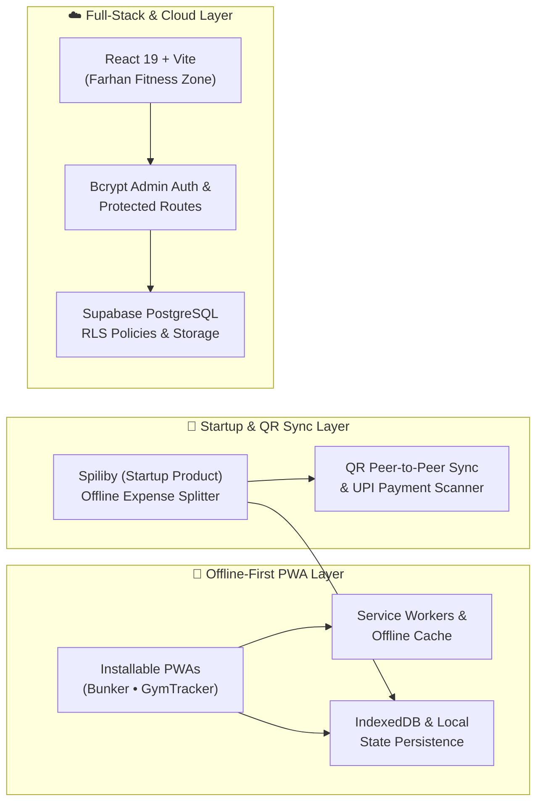

<div align="center">

<!-- ======================== HERO BANNER ======================== -->


<!-- ======================== TYPING ANIMATION ======================== -->
<a href="https://github.com/CuriousKartik">
  
</a>

<!-- ======================== SOCIAL & STATUS BADGES ======================== -->
<p align="center">
  <a href="https://www.linkedin.com/in/kartikeyguptatechy">
    
  </a>
  <a href="https://github.com/CuriousKartik">
    
  </a>
  <a href="https://leetcode.com/u/Kartikey7-Codes/">
    
  </a>
  
</p>

<!-- ======================== WHIRLING MINI BLACK HOLE CENTERPIECE ======================== -->
<p align="center">
  
</p>

<!-- ======================== QUICK NAVIGATION ======================== -->
<p align="center">
  <a href="#-about-me"><kbd> &nbsp;⚡ About Me&nbsp; </kbd></a>&nbsp;&nbsp;
  <a href="#-tech-arsenal"><kbd> &nbsp;🛠️ Tech Arsenal&nbsp; </kbd></a>&nbsp;&nbsp;
  <a href="#-flagship-projects"><kbd> &nbsp;🚀 Flagship Projects&nbsp; </kbd></a>&nbsp;&nbsp;
  <a href="#-engineering-architecture"><kbd> &nbsp;🧬 Architecture&nbsp; </kbd></a>&nbsp;&nbsp;
  <a href="#-competitive-programming"><kbd> &nbsp;🏆 LeetCode&nbsp; </kbd></a>&nbsp;&nbsp;
  <a href="#-github-telemetry"><kbd> &nbsp;📊 Telemetry&nbsp; </kbd></a>
</p>

</div>

---

## ⚡ About Me

<table>
<tr>
<td width="290" valign="top" align="center">
  
  <br/>
  <sub><b>🎤 Builder • Product Thinker • Problem Solver</b></sub>
  <br/><br/>
  
  
</td>
<td valign="top">

Hey there! I'm **Kartikey Gupta** — a **2nd-year undergraduate (Class of 2029)** who builds **offline-first Progressive Web Apps (PWAs)**, **full-stack web platforms**, and **student-focused startup products**.

I love turning everyday friction—whether it's **calculating college attendance margins**, ** managing class timetables**, **running QR-based gym check-ins**, or **launching a zero-internet group bill splitter**—into fast, practical tools that people actually use.

```bash
kartikey@singularity:~$ neofetch --developer
────────────────────────────────────────────────────────────
OS          : Web / PWA Runtime / Windows
Host        : Kartikey Gupta (@CuriousKartik)
Kernel      : 2nd-Year Undergrad • Class of 2029
Packages    : React 19, Vite, Supabase, Service Workers, IndexedDB
Shell       : JavaScript (ES6+) / HTML5 / CSS3 / SQL
Focus       : Offline-First PWAs • Full-Stack Web • Startup Products
Shipped     : Bunker, FarhanFitnessZone, Spiliby, GymTracker, ClassBoard
Status      : Open to Internships, Hackathons & Collabs 🚀
────────────────────────────────────────────────────────────
kartikey@singularity:~$ echo $PHILOSOPHY
"Build tools that solve real problems — even when the Wi-Fi dies."
```

<details>
<summary><b>🔍 Click to expand: My Engineering & Product Principles</b></summary>
<br/>

- **📡 Offline-First by Default:** Most student and field apps fail when campus Wi-Fi drops. I design with `Service Workers`, `IndexedDB`, and QR-based peer-to-peer data sync so tools work reliably anywhere.
- **🚀 Startup & Product Execution:** From spotting everyday student pain points to shaping product workflows, building web platforms, and collaborating on product launches like **[Spiliby](https://github.com/CuriousKartik/Spiliby)**.
- **🔐 Real-World Full-Stack Security:** Implementing `bcrypt` admin authentication, protected routes, and Supabase **Row-Level Security (RLS)** policies with cloud storage buckets.
- **⚡ Performance & UX Polish:** Fast load times, zero-dependency vanilla JS where appropriate, and modern React + Vite architectures when scaling up.

</details>

</td>
</tr>
</table>

---

## 🛠️ Tech Arsenal

<div align="center">

| Domain | Technologies & Tools |
| :--- | :--- |
| **Languages** |     |
| **Frontend & PWA** |      |
| **Backend & Database** |     |
| **Dev Tools & Workflow** |     |

<br/>


</div>

---

## 🚀 Flagship Projects

> **Every project below was built to solve a real problem** — from installable offline-first PWAs and full-stack platforms to student startup products.

<table>
<tr>
<td width="50%" valign="top">

### 📚 [Bunker](https://github.com/CuriousKartik/Bunker)
**Installable Attendance Tracker & Real-Time Bunk Calculator PWA**

An installable mobile-first **Progressive Web App** that tracks subject-wise attendance, computes real-time bunk eligibility margins, manages custom class timetables, and fires pre-class reminder notifications. Engineered with Service Workers for uninterrupted offline access.

<p>
  
  
  
  
</p>

[**↗ Explore Repository**](https://github.com/CuriousKartik/Bunker)

</td>
<td width="50%" valign="top">

### 🏋️ [Farhan Fitness Zone](https://github.com/CuriousKartik/FullStack-gym-website-)
**Production Full-Stack Gym Platform & Admin Suite**

A full-stack gym platform built on a scalable **React 19 + Vite + Supabase** architecture. Features secure `bcrypt` admin authentication, a customer review system with image/video uploads, an interactive BMI calculator, workout media gallery, and PostgreSQL Row-Level Security (RLS).

<p>
  
  
  
  
</p>

[**↗ Explore Repository**](https://github.com/CuriousKartik/FullStack-gym-website-)

</td>
</tr>

<tr>
<td width="50%" valign="top">

### 💸 [Spiliby](https://github.com/CuriousKartik/Spiliby)
**Startup Product • Offline-First Group Expense Splitter**

A startup product I conceived and built for college groups, roommates, and travellers to split expenses with **zero internet or backend**, using **QR-code peer-to-peer ledger syncing** and direct UPI QR scanning. Originally built as a web app and converted into a mobile app by my friend **Junaid**.

<p>
  
  
  
  
</p>

[**↗ Explore Repository**](https://github.com/CuriousKartik/Spiliby)

</td>
<td width="50%" valign="top">

### 📲 [GymTracker](https://github.com/CuriousKartik/GymTracker) & [ClassBoard](https://github.com/CuriousKartik/ClassBoard)
**QR-Code Gym Operations PWA & Campus Timetable Hub**

- **GymTracker:** Installable PWA with unique member QR check-ins, digital IDs, payment tracking, and renewal reminders ([**Membership App**](https://github.com/CuriousKartik/Gym-Membership-tracker-App)).
- **ClassBoard:** Unified scheduling platform for professors and students to manage class timetables and track upcoming lectures in one place.

<p>
  
  
  
  
</p>

[**↗ GymTracker Repo**](https://github.com/CuriousKartik/GymTracker) &nbsp;•&nbsp; [**↗ All Repositories**](https://github.com/CuriousKartik?tab=repositories)

</td>
</tr>
</table>

---

## 🧬 Engineering Architecture

How my applications are structured across **Offline-First PWAs**, **QR Sync Workflows**, and **Full-Stack Cloud Platforms**:



---

## 🏆 Competitive Programming

<div align="center">

Sharpening data structures, algorithms, and problem-solving consistency on **LeetCode**:

<a href="https://leetcode.com/u/Kartikey7-Codes/">
  
</a>

</div>

---

## 📊 GitHub Telemetry

<div align="center">


<br/><br/>


</div>

---

<div align="center">

### 🤝 Let's Build Something Impactful

Got an idea for an **offline-first tool**, a **full-stack product**, or a **startup collaboration**? Reach out anytime!

<p align="center">
  <a href="https://www.linkedin.com/in/kartikeyguptatechy">
    
  </a>
  <a href="https://github.com/CuriousKartik">
    
  </a>
  <a href="https://leetcode.com/u/Kartikey7-Codes/">
    
  </a>
</p>

<sub><b>Crafted with ⚡ by Kartikey Gupta (@CuriousKartik) • Class of 2029</b></sub>


</div>
