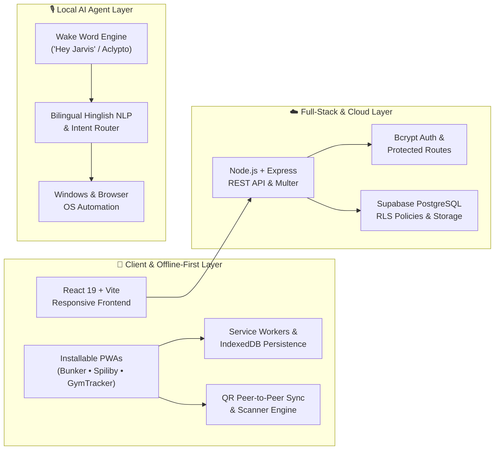

<div align="center">

<!-- ======================== HERO BANNER ======================== -->


<!-- ======================== TYPING ANIMATION ======================== -->
<a href="https://github.com/CuriousKartik">
  
</a>

<!-- ======================== SOCIAL & STATUS BADGES ======================== -->
<p align="center">
  <a href="https://www.linkedin.com/in/kartikeyguptatechy">
    
  </a>
  <a href="https://github.com/CuriousKartik">
    
  </a>
  <a href="https://leetcode.com/u/Kartikey7-Codes/">
    
  </a>
  
</p>

<!-- ======================== WHIRLING MINI BLACK HOLE CENTERPIECE ======================== -->
<p align="center">
  
</p>

<!-- ======================== QUICK NAVIGATION ======================== -->
<p align="center">
  <a href="#-about-me"><kbd> &nbsp;⚡ About Me&nbsp; </kbd></a>&nbsp;&nbsp;
  <a href="#-tech-arsenal"><kbd> &nbsp;🛠️ Tech Arsenal&nbsp; </kbd></a>&nbsp;&nbsp;
  <a href="#-flagship-projects"><kbd> &nbsp;🚀 Flagship Projects&nbsp; </kbd></a>&nbsp;&nbsp;
  <a href="#-engineering-architecture"><kbd> &nbsp;🧬 Architecture&nbsp; </kbd></a>&nbsp;&nbsp;
  <a href="#-competitive-programming"><kbd> &nbsp;🏆 LeetCode&nbsp; </kbd></a>&nbsp;&nbsp;
  <a href="#-github-telemetry"><kbd> &nbsp;📊 Telemetry&nbsp; </kbd></a>
</p>

</div>

---

## ⚡ About Me

<table>
<tr>
<td width="290" valign="top" align="center">
  
  <br/>
  <sub><b>🎤 Builder • Speaker • Problem Solver</b></sub>
  <br/><br/>
  
  
</td>
<td valign="top">

Hey there! I'm **Kartikey Gupta** — a **2nd-year undergraduate (Class of 2029)** obsessed with building **offline-first Progressive Web Apps (PWAs)**, **production full-stack web platforms**, and **local AI desktop agents**.

Instead of building toy tutorials, I look for friction in everyday life—whether it's **calculating college attendance margins**, **splitting group trip bills without mobile data**, **running QR-based gym check-ins**, or **controlling a Windows PC hands-free in Hinglish**—and engineer fast, zero-fluff tools that people actually use.

```bash
kartikey@singularity:~$ neofetch --developer
────────────────────────────────────────────────────────────
OS          : Windows / Web / PWA Runtime / Flutter
Host        : Kartikey Gupta (@CuriousKartik)
Kernel      : 2nd-Year Undergrad • Class of 2029
Packages    : React 19, Vite, Node.js, Express, Supabase, Dart
Shell       : JavaScript (ES6+) / TypeScript / Python / SQL
Focus       : Offline-First PWAs • Full-Stack Apps • Local AI
Shipped     : Aclypto (Jarvis), Spiliby, Bunker, FarhanFitness
Status      : Open to Internships, Hackathons & Collabs 🚀
────────────────────────────────────────────────────────────
kartikey@singularity:~$ echo $PHILOSOPHY
"Build software that works effortlessly — even when the Wi-Fi dies."
```

<details>
<summary><b>🔍 Click to expand: My Engineering Principles & Current Focus</b></summary>
<br/>

- **📡 Offline-First by Default:** Most student and field apps fail when campus Wi-Fi drops. I design with `Service Workers`, `IndexedDB`, and QR-based peer-to-peer payloads so apps stay functional anywhere.
- **🔐 Real-World Full-Stack Security:** From `bcrypt` admin authentication and JWT middleware to Supabase **Row-Level Security (RLS)** policies and media storage buckets.
- **🎙️ Voice & Local AI Interfaces:** Building low-latency desktop assistants ([Aclypto / Jarvis](https://github.com/CuriousKartik/Aclypto)) that execute real OS/browser workflows locally with zero cloud lock-in.
- **⚡ Performance & UX Polish:** Fast load times, zero-dependency vanilla JS where appropriate, and modern React + Vite architectures when scaling up.

</details>

</td>
</tr>
</table>

---

## 🛠️ Tech Arsenal

<div align="center">

| Domain | Technologies & Tools |
| :--- | :--- |
| **Languages** |        |
| **Frontend & Mobile** |      |
| **Backend & Cloud** |      |
| **Dev Tools & Workflow** |     |

<br/>


</div>

---

## 🚀 Flagship Projects

> **Every project below was built to solve a real workflow problem** — engineered from scratch with clean UI, offline resilience, or production-grade backend architecture.

<table>
<tr>
<td width="50%" valign="top">

### 🎙️ [Aclypto (Jarvis)](https://github.com/CuriousKartik/Aclypto)
**Voice-Activated Local AI Desktop Assistant for Windows**

A privacy-first personal AI assistant woken with `"Hey Jarvis"`. Converses naturally in **English & Hindi (Hinglish)**, controls Windows apps & browser tabs, takes voice-dictated notes, schedules calendar events, and auto-generates PowerPoint presentations—all running locally on your machine.

<p>
  
  
  
  
</p>

[**↗ Explore Repository**](https://github.com/CuriousKartik/Aclypto)

</td>
<td width="50%" valign="top">

### 💸 [Spiliby](https://github.com/CuriousKartik/Spiliby)
**Offline-First Group Expense Splitter & QR Ledger**

Built for college groups, roommates, and trips where internet is spotty. Supports equal, percentage, and custom bill splits with **zero backend or login**. Uses **QR-code peer-to-peer data syncing** to share group balances offline and integrates direct UPI QR scanning to settle debts instantly.

<p>
  
  
  
  
</p>

[**↗ Explore Repository**](https://github.com/CuriousKartik/Spiliby) &nbsp;•&nbsp; [**↗ Web Version**](https://github.com/CuriousKartik/SpilibyWeb)

</td>
</tr>

<tr>
<td width="50%" valign="top">

### 📚 [Bunker](https://github.com/CuriousKartik/Bunker)
**Installable Attendance Tracker & Real-Time Bunk Calculator PWA**

An installable mobile-first **Progressive Web App** that tracks subject-wise attendance, computes real-time bunk eligibility margins, manages custom class timetables, and fires pre-class reminder notifications. Engineered with Service Workers for uninterrupted offline access.

<p>
  
  
  
  
</p>

[**↗ Explore Repository**](https://github.com/CuriousKartik/Bunker)

</td>
<td width="50%" valign="top">

### 🏋️ [Farhan Fitness Zone](https://github.com/CuriousKartik/FullStack-gym-website-)
**Production Full-Stack Gym Platform & Admin Suite**

A full-stack conversion of a fitness brand into a scalable **React 19 + Node.js/Express + Supabase** architecture. Features `bcrypt` admin authentication, customer review system with image/video uploads, interactive BMI calculator, workout media hub, and PostgreSQL Row-Level Security (RLS).

<p>
  
  
  
  
</p>

[**↗ Explore Repository**](https://github.com/CuriousKartik/FullStack-gym-website-)

</td>
</tr>

<tr>
<td width="50%" valign="top">

### 📲 [GymTracker](https://github.com/CuriousKartik/GymTracker)
**QR-Code Gym Check-In & Membership Management PWA**

Streamlines daily gym operations with **unique member QR codes** and digital membership IDs. Admins scan QR codes for instant check-ins while tracking attendance history, payment logs, renewal reminders, and member analytics from a centralized dashboard.

<p>
  
  
  
  
</p>

[**↗ Explore Repository**](https://github.com/CuriousKartik/GymTracker) &nbsp;•&nbsp; [**↗ Membership App**](https://github.com/CuriousKartik/Gym-Membership-tracker-App)

</td>
<td width="50%" valign="top">

### 🗓️ ClassBoard & Campus Utilities
**Collaborative Timetable & Academic Workflow Tools**

A unified hub designed for professors and students to coordinate class timetables, room changes, and upcoming lectures in real time—paired with experimental utilities like [**Drainlog**](https://github.com/CuriousKartik/Drainlog) (Python) and [**HCHO**](https://github.com/CuriousKartik/HCHO) (JavaScript).

<p>
  
  
  
  
</p>

[**↗ View All 12+ Repositories**](https://github.com/CuriousKartik?tab=repositories)

</td>
</tr>
</table>

---

## 🧬 Engineering Architecture

How my projects fit together across **Offline-First Client Apps**, **Full-Stack Cloud Backends**, and **Local AI Automation**:



---

## 🏆 Competitive Programming

<div align="center">

Sharpening data structures, algorithms, and problem-solving consistency on **LeetCode**:

<a href="https://leetcode.com/u/Kartikey7-Codes/">
  
</a>

</div>

---

## 📊 GitHub Telemetry

<div align="center">


<br/><br/>


</div>

---

<div align="center">

### 🤝 Let's Build Something Impactful

Got an idea for an **offline-first tool**, a **full-stack product**, or a **hackathon collaboration**? Reach out anytime!

<p align="center">
  <a href="https://www.linkedin.com/in/kartikeyguptatechy">
    
  </a>
  <a href="https://github.com/CuriousKartik">
    
  </a>
  <a href="https://leetcode.com/u/Kartikey7-Codes/">
    
  </a>
</p>

<sub><b>Crafted with ⚡ by Kartikey Gupta (@CuriousKartik) • Class of 2029</b></sub>


</div>
